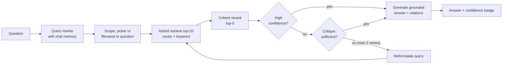

# DocSense

**Ask questions about your PDFs and get answers grounded in the document, with a page citation for every claim.**

DocSense is a production-pattern RAG (retrieval-augmented generation) application. It retrieves the most relevant passages, checks whether they actually answer the question, and either answers with citations or says it could not find a reliable answer. It does not guess.

**Live demo:** https://docsense.victoriousocean-b8bffaf4.uaenorth.azurecontainerapps.io
(Scales to zero when idle, so the first load can take 20 to 30 seconds.)

---

## What it does

- Upload PDFs, or load the demo paper (*The Honey Bee Apis mellifera*, Biology 2022, open access) and read it in the built-in viewer first.
- Ask in plain language. Answers cite `[Source: file | Page N]` and carry a confidence badge (High / Medium / Low).
- Out-of-scope questions ("What is the capital of France?") get an honest "not found" instead of an answer from the model's general knowledge.
- Follow-up questions work: conversation memory rewrites "what about its methods?" into a standalone query before retrieval.
- Name a document in the question ("what does report2024.pdf say...") and the search is scoped to that document automatically. A sidebar picker does the same explicitly.

## How a question is answered



The retrieve, critique, revise, respond loop is a **LangGraph state machine implementing the Reflection pattern** (`generation/graph.py`). Strong retrievals skip the critique; borderline ones are judged by an LLM and retried with a reformulated query, capped at 2 retries for bounded cost and latency.

## Evaluation

Two evaluators run over the same fixed 15-question set: 12 answerable questions about a research paper, and 3 deliberately out-of-scope questions that must be refused. Both use the same fixed judge model (OpenAI `gpt-4o-mini`), so when the system under test changes, the grader does not.

### Custom LLM-as-judge harness

`eval/run_eval.py` scores faithfulness and answer relevancy for every question. It was used to validate each backend migration before switching live traffic:

| Stack | Faithfulness | Answer relevancy |
|---|---|---|
| OpenAI gpt-4o-mini + Pinecone | 0.83 | 0.87 |
| OpenAI gpt-4o-mini + Azure AI Search | 0.83 | 0.84 |
| **Azure OpenAI gpt-4.1-mini + Azure AI Search (live)** | **0.87** | **0.83** |

Targets: faithfulness > 0.80, relevancy > 0.70. Latest run: `eval/results_20261103_185254.json`. The two remaining misses are questions where the right passage is retrieved but scores under the 0.1 relevance cutoff, so the system declines. The cutoff is kept on purpose: lowering it to pass a 15-question test set would loosen the hallucination guard for every future document.

### RAGAS

The same questions are also scored with **RAGAS** (`eval/run_ragas.py`), which adds retrieval-quality metrics the custom harness doesn't have. Live stack:

| Metric | What it measures | Score |
|---|---|---|
| Context precision | Retrieved passages are relevant and ranked near the top | **0.78** |
| Context recall | Retrieval found what the reference answer needs | **0.88** |
| Faithfulness | Claims are supported by the retrieved passages | **0.93** |
| Answer relevancy | The answer addresses the question | **0.85** |
| Out-of-scope refusals | Declined instead of answering from general knowledge | **3/3** |

Retrieval metrics cover all 12 answerable questions, including the two the confidence gate blocked. Both of those have context recall 1.0: the right passages were retrieved, and the conservative cutoff, not retrieval, is why they fall back. Answer metrics cover the 10 answered questions. Results: `eval/ragas_results_20261103_205524.json`.

## Tech stack

| Layer | Technology |
|---|---|
| Parsing / chunking | PyMuPDF, LangChain text splitter (400 chars, 160 overlap) |
| Embeddings / LLM | **Azure OpenAI**: `gpt-4.1-mini` (answers), `text-embedding-3-small` (embeddings) |
| Retrieval store | **Azure AI Search** hybrid vector + BM25 (production), Pinecone (rollback), ChromaDB (local dev) |
| Reranking | Cohere `rerank-english-v3.0` (cross-encoder) |
| Orchestration | LangGraph (Reflection pattern) |
| Frontend | Streamlit, in-app PDF viewer |
| Sessions | SQLite |
| Observability | LangSmith tracing |
| CI | GitHub Actions: flake8 + unit tests on every push |
| Evaluation | RAGAS + custom LLM-as-judge harness, fixed judge model |
| Hosting | Docker, Azure Container Registry, **Azure Container Apps** (scale to zero) |
| Secrets | **Azure Key Vault** (RBAC), read at runtime by the app's **managed identity**; image pulls from ACR also use the managed identity, so the app holds no passwords |

Retrieval runs on **Azure AI Search** (hybrid vector + keyword), migrated from Pinecone and validated by the eval harness before cutover: faithfulness 0.83 / relevancy 0.84 on Azure versus 0.83 / 0.87 on Pinecone. Backends are switched by feature flags (`USE_AZURE_SEARCH`, `USE_PINECONE`), so rolling back is a config change. Models run on **Azure OpenAI** (`USE_AZURE`): the original `gpt-4o-mini` can no longer be deployed on Azure, so answers use `gpt-4.1-mini`, the closest drop-in. Azure and OpenAI `text-embedding-3-small` vectors were measured identical (cosine 1.00000), so the index carried over without re-embedding. The whole stack, every component switchable by flag, now runs on Azure.

## Engineering notes

Design decisions and their trade-offs are recorded in **[docs/ADR.md](docs/ADR.md)**. A few problems worth reading about:

- **Reflection made a correct answer worse.** A trace showed the critique step rejecting a retrieval that scored 0.87 and even named the right answer, then approving a worse one. Fix: retrievals that already clear the high-confidence bar skip critique. An LLM judge should not overrule a strong deterministic signal.
- **A summary chunk the reranker kept throwing away.** Each document gets a synthetic summary chunk so "what is this paper about?" has something to match. Written as labelled metadata, the cross-encoder scored it 0.001 for exactly that question. Rewritten as a prose sentence (wording chosen by measured rerank scores) it scores above 0.92, and eval relevancy rose from 0.73 to 0.87.
- **Eval scores dropped with no code change.** New documents had been added to the shared index, so the harness was silently searching three unrelated papers. The harness now pins its own corpus. A benchmark is only valid for the corpus it was measured on.
- **Opposite score scales.** Vector distance (lower is better) and rerank relevance (higher is better) were once compared as one scale. Confidence logic now branches on which score is present.
- **Migrating to Azure AI Search surfaced three bugs in code that had never run.** Chunk IDs (built from file paths) contain `/`, `.` and spaces, which Azure document keys reject, so every upload would have failed; keys are now base64url-encoded. Filenames with an apostrophe broke the OData scope filter; quotes are now escaped. And ingestion only knew Pinecone, so with the Azure flag on, uploads went to Pinecone while questions searched an empty Azure index. Caught by running the eval before switching traffic, not after.
- **Keeping the evaluation honest.** The judge model is pinned, so swapping the app's model doesn't also swap the grader. The first RAGAS run reported context precision 0.92, but 5 of 12 scores had silently timed out; the complete figure is 0.78. A phrase-matching refusal check also marked a correct, conversationally worded refusal as a failure; refusals are now classified by the judge. Check what an average is averaging before reporting it.
- **No secrets in the app.** All API keys live in Azure Key Vault. The Container App has a system-assigned managed identity with read-only access (Key Vault Secrets User) scoped to that one vault, and its secrets are Key Vault references, not values. The registry password was removed too: image pulls use the same identity (AcrPull). Rotating a key means updating the vault; nothing in code, the image or app config changes.
- **Public deployment hardening.** The empty scope picker originally searched the whole shared index, which would expose other visitors' uploads; it now searches only the current session's documents.

## Troubleshooting: bugs found and fixed

Every non-trivial bug hit while building and deploying DocSense, with its root cause. Full write-ups are in the project's session log.

**Retrieval and answer quality**

| Symptom | Root cause | Fix |
|---|---|---|
| Vague, weakly matched retrieval | 1000-character chunks mixed several ideas, blurring each embedding (semantic dilution) | 400-character chunks, one idea per chunk |
| Good answers wrongly falling back to "not found" | Vector distance (lower is better) and rerank relevance (higher is better) checked against one threshold | Confidence logic detects which score is present and applies the right scale |
| Answers that only quoted passages, or refused when evidence was indirect | System prompt behaved like a citation machine | Prompt rewritten to allow synthesis across passages while keeping the grounding boundary |
| Follow-up questions ("where do they work?") falling back | Retrieval saw the follow-up without its context | Query rewriting from conversation memory before retrieval |
| Facts split across two chunks never retrieved | Chunk boundaries cut sentences apart | Chunk overlap raised from 80 to 160 characters |
| "What is this paper about?" had nothing to match | Retrieval was pure content similarity; documents had no identity | One synthetic title/summary chunk per document at ingest time |
| That summary chunk was still dropped for "What is the main topic of the paper?" | Written as labelled metadata; the reranker scored it 0.001 because it didn't read like an answer | Rewritten as one prose sentence, wording chosen by measured rerank score (0.001 to 0.92+) |
| Reflection made a correct answer worse | The LLM critique rejected a 0.87-relevance retrieval, then approved a worse retry | Retrievals that already clear the high-confidence bar skip critique |
| Changing the document scope gave answers about the previous document | Conversation memory carried into query rewriting for the new scope | Memory resets whenever the scope selection changes |

**Evaluation**

| Symptom | Root cause | Fix |
|---|---|---|
| Eval run crashed at question 11 with a rate-limit error | The documented 7-second pause between questions had never been implemented | Pause added; Cohere free tier allows 10 calls per minute |
| Faithfulness scores inconsistent run to run | The judge was shown filename and page labels instead of the retrieved text | The real retrieved context is passed to the judge |
| Scores dropped with no code change | New documents added to the shared index; the harness searched unrelated papers | Harness pinned to the corpus its questions were written for |
| A backend switch would also have switched the grader | The judge used the same model setting as the app | Judge pinned to OpenAI `gpt-4o-mini` |
| RAGAS would not import | RAGAS imports a module removed from newer LangChain | RAGAS upgraded without touching app packages, plus an eval-only compatibility shim |
| RAGAS context precision reported as 0.92 | 5 of 12 scores had timed out and were silently left out of the average | Fewer parallel calls and more retries; the complete figure is 0.78 |
| A correct refusal scored as a failure | The refusal check only matched the fixed fallback phrase, not a conversational refusal | Refusals classified by the judge model |

**Azure migration and deployment**

| Symptom | Root cause | Fix |
|---|---|---|
| Docker image would crash on Azure | `.dockerignore` excluded the whole `db/` folder, including session code; it only worked locally because docker-compose mounted it | Ship the code, exclude only the data files |
| Visitors could retrieve other visitors' uploaded PDFs | An empty scope picker searched the entire shared index | Search limited to documents loaded in the current session |
| Container ran stale code; Pinecone silently missing from the image | `requirements.txt` saved as UTF-16 by PowerShell, plus a stuck Docker build cache | File converted to UTF-8, clean rebuild |
| Every Azure AI Search upload would have failed | Chunk IDs built from file paths contain `/`, `.` and spaces, which Azure keys reject | Keys base64url-encoded |
| Filenames with an apostrophe broke document scoping | Unescaped quote in the OData filter | Quotes escaped |
| With Azure AI Search on, every answer would be "not found" | Ingestion still wrote to Pinecone while retrieval read the empty Azure index | Ingestion and retrieval use the same backend switch |
| `gpt-4o-mini` could not be deployed on Azure OpenAI | Model version in Azure's deprecating state | Switched to `gpt-4.1-mini`, validated by eval; embedding parity confirmed (cosine 1.0) |
| PDFs from a subfolder ended up in the image | `.dockerignore` `*.pdf` only matches the repository root | `**/*.pdf` with the demo folder re-included |

**Interface**

| Symptom | Root cause | Fix |
|---|---|---|
| Citations showed temporary file paths | Uploads were indexed under their temp-file path | Original filename passed through as the source name |
| App took about 60 seconds to load | Model clients and pipeline imports rebuilt on every Streamlit rerun | Lazy client creation plus cached imports |
| Icons rendered as words ("keyboard_double_arrow_left") | A global font override also replaced the icon font | Override narrowed to text elements |
| Sources panel listed "Page 0" and internal paths like `uploads/` | The summary chunk is stored as page 0; storage prefixes were displayed | Summary chunk hidden from Sources; document names only |

## Run locally

Requires Python 3.11 and API keys for OpenAI, Cohere and Pinecone. The Azure backends are optional and switched on by flags.

```bash
git clone https://github.com/an-1272/docsense.git
cd docsense
python -m venv venv
venv\Scripts\activate            # macOS/Linux: source venv/bin/activate
pip install -r requirements.txt
```

Create a `.env` file:

```
OPENAI_API_KEY=...                # OpenAI path + the eval judge
COHERE_API_KEY=...
PINECONE_API_KEY=...
PINECONE_INDEX_NAME=docsense
USE_PINECONE=true
# optional: Azure AI Search (create the index with: python -m deploy.create_search_index)
USE_AZURE_SEARCH=false
AZURE_SEARCH_ENDPOINT=https://<service>.search.windows.net
AZURE_SEARCH_KEY=...
AZURE_SEARCH_INDEX=docsense
# optional: Azure OpenAI
USE_AZURE=false
AZURE_OPENAI_ENDPOINT=https://<resource>.openai.azure.com/
AZURE_OPENAI_API_KEY=...
AZURE_OPENAI_DEPLOYMENT_NAME=gpt-4.1-mini
AZURE_OPENAI_EMBEDDING_DEPLOYMENT=text-embedding-3-small
# optional, deploy only: secrets as Key Vault references
KEY_VAULT_NAME=<vault-name>
LANGSMITH_TRACING=true
LANGSMITH_API_KEY=...
LANGSMITH_PROJECT=docsense
```

Then:

```bash
streamlit run app.py             # app on http://localhost:8501
pytest tests/ -v                 # unit tests, no API calls
python -m eval.run_eval          # custom LLM-as-judge harness (uses API credits)
pip install -r requirements-eval.txt && python -m eval.run_ragas   # RAGAS evaluation
docker compose up                # or run in Docker
```

### Deploy to Azure Container Apps

```bash
docker build --platform linux/amd64 -t docsense:latest .
powershell -ExecutionPolicy Bypass -File deploy\deploy_azure.ps1
```

The script pushes the locally built image to Azure Container Registry, then creates or updates the Container App (scale to zero, max 1 replica). Feature flags and settings come from `.env`. With `KEY_VAULT_NAME` set, the app receives Key Vault references resolved by its managed identity instead of key values, and the script stops if a referenced secret is missing from the vault. Without it, keys are stored as Container App secrets. The Azure AI Search index is created once with `python -m deploy.create_search_index`.

## Project structure

```
app.py                  Streamlit UI (chat, sources, document viewer)
pipeline.py             ask(): runs the LangGraph state machine
generation/             graph.py (Reflection), critique.py, generator.py, memory.py, prompts.py
retrieval/              Pinecone / ChromaDB / Azure AI Search + rerank, scope_detect.py
ingestion/              parser, chunker, title_chunk.py, embedders
eval/                   15-question dataset, LLM-as-judge runner, RAGAS runner, results
tests/                  unit tests (run in CI)
deploy/                 Azure Container Apps deploy script, Azure AI Search index setup
docs/ADR.md             architecture decision record
```

## Demo document

*The Honey Bee Apis mellifera: An Insect at the Interface between Human and Ecosystem Health*, Papa, G. et al., Biology 2022, 11, 233. https://doi.org/10.3390/biology11020233. Open access under CC BY 4.0.

---

Built by Angelina Raju.
