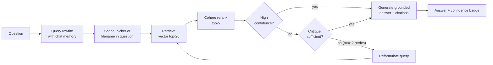

# DocSense

**Ask questions about your PDFs and get answers grounded in the document, with a page citation for every claim.**

DocSense is a production-pattern RAG (retrieval-augmented generation) application. It retrieves the most relevant passages, checks whether they actually answer the question, and either answers with citations or says it could not find a reliable answer. It does not guess.

**Live demo:** https://docsense.victoriousocean-b8bffaf4.uaenorth.azurecontainerapps.io
(Scales to zero when idle, so the first load can take 20 to 30 seconds.)

---

## What it does

- Upload PDFs, or load the demo paper (*The Honey Bee Apis mellifera*, Biology 2022, open access) and read it in the built-in viewer first.
- Ask in plain language. Answers cite `[Source: file | Page N]` and carry a confidence badge (High / Medium / Low).
- Out-of-scope questions ("What is the capital of France?") get an honest "not found" instead of an answer from the model's general knowledge.
- Follow-up questions work: conversation memory rewrites "what about its methods?" into a standalone query before retrieval.
- Name a document in the question ("what does report2024.pdf say...") and the search is scoped to that document automatically. A sidebar picker does the same explicitly.

## How a question is answered



The retrieve, critique, revise, respond loop is a **LangGraph state machine implementing the Reflection pattern** (`generation/graph.py`). Strong retrievals skip the critique; borderline ones are judged by an LLM and retried with a reformulated query, capped at 2 retries for bounded cost and latency.

## Evaluation

LLM-as-judge harness (`eval/run_eval.py`) over a fixed 15-question set: 12 answerable questions and 3 deliberately out-of-scope ones that must be refused.

| Metric | Score | Target |
|---|---|---|
| Faithfulness (claims supported by retrieved context) | **0.83** | > 0.80 |
| Answer relevancy (answer addresses the question) | **0.87** | > 0.70 |

Latest run: `eval/results_20261103_174426.json`. The two remaining misses are questions where the right passage is retrieved but scores under the 0.1 relevance cutoff. The cutoff is kept on purpose: lowering it to pass a 15-question test set would loosen the hallucination guard for every future document.

## Tech stack

| Layer | Technology |
|---|---|
| Parsing / chunking | PyMuPDF, LangChain text splitter (400 chars, 160 overlap) |
| Embeddings / LLM | OpenAI `text-embedding-3-small`, `gpt-4o-mini` |
| Retrieval store | **Azure AI Search** hybrid vector + BM25 (production), Pinecone (rollback), ChromaDB (local dev) |
| Reranking | Cohere `rerank-english-v3.0` (cross-encoder) |
| Orchestration | LangGraph (Reflection pattern) |
| Frontend | Streamlit, in-app PDF viewer |
| Sessions | SQLite |
| Observability | LangSmith tracing |
| CI | GitHub Actions: flake8 + unit tests on every push |
| Hosting | Docker, Azure Container Registry, **Azure Container Apps** (scale to zero, keys stored as Container App secrets), **Azure AI Search** |

Retrieval runs on **Azure AI Search** (hybrid vector + keyword), migrated from Pinecone and validated by the eval harness before cutover: faithfulness 0.83 / relevancy 0.84 on Azure versus 0.83 / 0.87 on Pinecone. Backends are switched by feature flags (`USE_AZURE_SEARCH`, `USE_PINECONE`), so rolling back is a config change. An Azure OpenAI backend (`USE_AZURE`) is implemented and pending validation; generation currently uses the OpenAI API.

## Engineering notes

Design decisions and their trade-offs are recorded in **[docs/ADR.md](docs/ADR.md)**. A few problems worth reading about:

- **Reflection made a correct answer worse.** A trace showed the critique step rejecting a retrieval that scored 0.87 and even named the right answer, then approving a worse one. Fix: retrievals that already clear the high-confidence bar skip critique. An LLM judge should not overrule a strong deterministic signal.
- **A summary chunk the reranker kept throwing away.** Each document gets a synthetic summary chunk so "what is this paper about?" has something to match. Written as labelled metadata, the cross-encoder scored it 0.001 for exactly that question. Rewritten as a prose sentence (wording chosen by measured rerank scores) it scores above 0.92, and eval relevancy rose from 0.73 to 0.87.
- **Eval scores dropped with no code change.** New documents had been added to the shared index, so the harness was silently searching three unrelated papers. The harness now pins its own corpus. A benchmark is only valid for the corpus it was measured on.
- **Opposite score scales.** Vector distance (lower is better) and rerank relevance (higher is better) were once compared as one scale. Confidence logic now branches on which score is present.
- **Migrating to Azure AI Search surfaced three bugs in code that had never run.** Chunk IDs (built from file paths) contain `/`, `.` and spaces, which Azure document keys reject, so every upload would have failed; keys are now base64url-encoded. Filenames with an apostrophe broke the OData scope filter; quotes are now escaped. And ingestion only knew Pinecone, so with the Azure flag on, uploads went to Pinecone while questions searched an empty Azure index. Caught by running the eval before switching traffic, not after.
- **Public deployment hardening.** The empty scope picker originally searched the whole shared index, which would expose other visitors' uploads; it now searches only the current session's documents.

## Run locally

Requires Python 3.11 and API keys for OpenAI, Cohere and Pinecone.

```bash
git clone https://github.com/an-1272/docsense.git
cd docsense
python -m venv venv
venv\Scripts\activate            # macOS/Linux: source venv/bin/activate
pip install -r requirements.txt
```

Create a `.env` file:

```
OPENAI_API_KEY=...
COHERE_API_KEY=...
PINECONE_API_KEY=...
PINECONE_INDEX_NAME=docsense
USE_PINECONE=true
# optional: Azure AI Search (create the index with: python -m deploy.create_search_index)
USE_AZURE_SEARCH=false
AZURE_SEARCH_ENDPOINT=https://<service>.search.windows.net
AZURE_SEARCH_KEY=...
AZURE_SEARCH_INDEX=docsense
LANGSMITH_TRACING=true
LANGSMITH_API_KEY=...
LANGSMITH_PROJECT=docsense
```

Then:

```bash
streamlit run app.py             # app on http://localhost:8501
pytest tests/ -v                 # unit tests, no API calls
python -m eval.run_eval          # evaluation harness (uses API credits)
docker compose up                # or run in Docker
```

Deploy to Azure Container Apps: `deploy/deploy_azure.ps1` (builds nothing in the cloud; pushes the local image to ACR and creates or updates the app, reading keys from `.env` into Container App secrets).

## Project structure

```
app.py                  Streamlit UI (chat, sources, document viewer)
pipeline.py             ask(): runs the LangGraph state machine
generation/             graph.py (Reflection), critique.py, generator.py, memory.py, prompts.py
retrieval/              Pinecone / ChromaDB / Azure AI Search + rerank, scope_detect.py
ingestion/              parser, chunker, title_chunk.py, embedders
eval/                   15-question dataset, LLM-as-judge runner, results
tests/                  unit tests (run in CI)
deploy/                 Azure Container Apps deploy script, Azure AI Search index setup
docs/ADR.md             architecture decision record
```

## Demo document

*The Honey Bee Apis mellifera: An Insect at the Interface between Human and Ecosystem Health*, Papa, G. et al., Biology 2022, 11, 233. https://doi.org/10.3390/biology11020233. Open access under CC BY 4.0.

---

Built by Angelina Raju.
